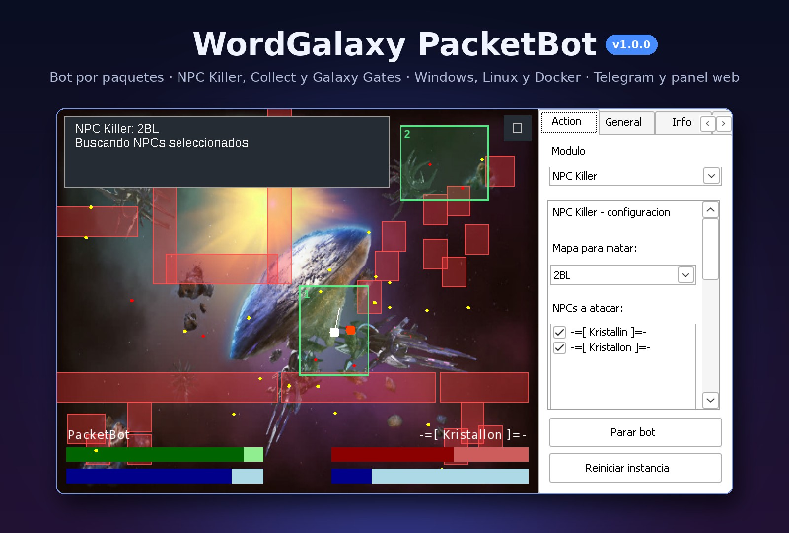

# WordGalaxy PacketBot

<p align="center">
  
</p>

<p align="center">
  <a href="../../releases/latest"><b>Descargar la última versión</b></a> ·
  <a href="docs/RELEASES.md">Versiones</a> ·
  <a href="docs/DOCKER.md">Docker</a> ·
  <a href="docs/LINUX_SERVER.md">Servidor Linux</a>
</p>

<p align="center"><sub>Captura de la ventana real con una partida de ejemplo (<a href="tools/screenshot/README.md">cómo se hace</a>).</sub></p>

Bot por paquetes para WordGalaxy, con dos frontends sobre el mismo motor:

| Proyecto | Plataforma | Uso |
| --- | --- | --- |
| `PacketBot.Core` | .NET 8, multiplataforma | Protocolo, sesiones, navegación, módulos (Collect, NPC Killer, Galaxy Gates), formaciones, boosters, Telegram, ajustes. |
| `PacketBot.Windows` | Windows (WinForms) | Aplicación de escritorio con pestañas por cuenta, minimapa y ajustes visuales. |
| `PacketBot.Server` | Linux / Docker (también Windows) | Servidor sin interfaz: Telegram y panel web. Pensado para un servidor Linux o Docker. |

Las dos versiones comparten el fichero de ajustes de cada cuenta (`WordGalaxyPacketBot/settings/<hash>.json`) y los mismos comandos de Telegram.

## Compilar y probar

```bash
dotnet build PacketBot.sln            # en Linux: añade -p:EnableWindowsTargeting=true
dotnet test PacketBot.sln
```

## Documentación

- [Servidor Linux: configuración, Telegram, systemd](docs/LINUX_SERVER.md)
- [Docker](docs/DOCKER.md)
- [Versiones, compilación automática del .exe y releases](docs/RELEASES.md)
- [Barreras de mapa (zonas POI)](docs/BARRIERS.md)
- [Energy Leech en NPC Killer](docs/ENERGY_LEECH.md)
- [Zonas preferidas de NPC Killer](docs/NPC_ZONES.md)
- [Estaciones del mapa y lo que tiene la nave](docs/SHIP_AND_STATIONS.md)
- [Protocolo: registro, catálogo y cobertura](docs/PROTOCOL.md) · [cobertura actual](docs/protocol/COVERAGE.md)
- [Ejemplo de ajustes](docs/settings.example.json)
- Normas para cambios: [AGENTS.md](AGENTS.md)
